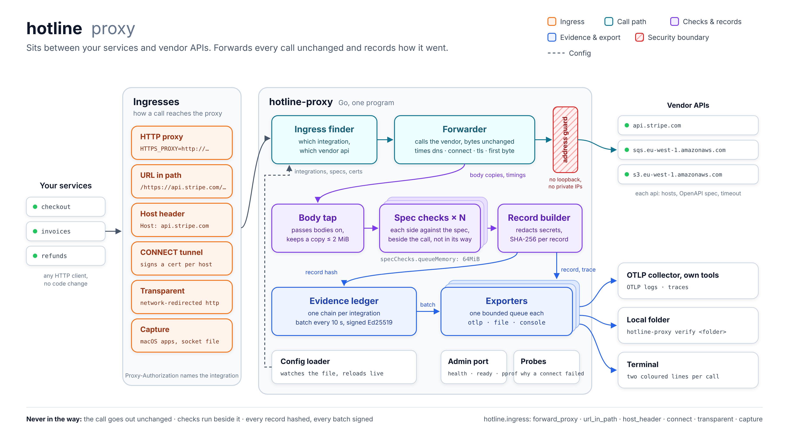

# Hotline



Hotline keeps track of the third-party APIs your apps call: payments, AWS, booking, anything over HTTP.

The Hotline proxy sits between your apps and those vendors. For every call it:

- checks the request and the response against the vendor's OpenAPI spec (path, query, headers, cookies, and JSON or XML bodies);
- times each step (DNS lookup, connect, TLS, waiting for the vendor) as an OpenTelemetry trace;
- writes a record of the call, with secrets taken out, signed so it can't be quietly changed later;
- sends it all over OTLP (the OpenTelemetry protocol) to the tools you already use, such as Grafana.

Apps reach the proxy through the ingress that suits them: as an HTTP proxy, with `CONNECT`, with the vendor address in the path, by Host header, or by a transparent redirect. Signed AWS calls stay valid.

The same parts as a C4 model, with a view of the system, its containers and the proxy's parts: [docs/architecture/](docs/architecture/README.md).

## Status

Early, and not released yet. The proxy works end to end and runs against real AWS in the shop example below. Tracking vendor SLAs and alerting on them come next.

## Try it

- [A small shop on AWS](examples/aws-shop/README.md): four apps calling ten AWS services through Hotline, with two mistakes caught on purpose.
- [The Docker image and a Kubernetes sidecar](docs/proxy-docker-image.md).

## Build

You need Go 1.27 or newer. From the root of the repo:

```
cd src/hotline-proxy
go build -o hotline-proxy ./cmd
./hotline-proxy version
```

Or build the Docker image for both platforms, also from the root of the repo. It builds the Linux programs first and the image copies them:

```
make image
```

## Run

1. Write a config file. Every setting is in [A full config](#a-full-config) below; a smaller working example, with its specs and sample calls, is in [src/hotline-proxy/testdata/proxy-example/](src/hotline-proxy/testdata/proxy-example/).
2. Check it, then start the proxy:

   ```
   ./hotline-proxy validate --config hotline-proxy.yaml
   ./hotline-proxy run --config hotline-proxy.yaml
   ```

3. Point your apps at it as their HTTP proxy, with the app's name as the user name, for example `HTTPS_PROXY=http://checkout:x@localhost:8080`.
4. Records and traces go to the OTLP addresses in the config, for example a local OpenTelemetry Collector or Grafana Cloud.

Ctrl+C stops it after the calls in progress finish. `./hotline-proxy run --help` lists every flag; details are in [docs/proxy-program.md](docs/proxy-program.md). The proxy picks up changes to its config, specs, keys and certificates within 5 seconds, or at once on `kill -HUP` ([docs/proxy-config-reload.md](docs/proxy-config-reload.md)). Health checks for Kubernetes, `/livez` and `/readyz`, answer on the admin address ([docs/proxy-health-checks.md](docs/proxy-health-checks.md)).

## A full config

Every section the proxy reads, with each setting explained. Only one listener and one exporter are needed to start; everything else is optional or has a default. `hotline-proxy validate` passes on this file as it is, given the certificates and specs it names and the `OTLP_TOKEN` and `POD_NAME` environment variables. Each section's detail is in [docs/](docs/README.md): listeners and certs in [proxy-listeners.md](docs/proxy-listeners.md), exporters in [otel-export.md](docs/otel-export.md), the ledger in [proxy-ledger.md](docs/proxy-ledger.md).

```yaml
# Every section of the config, with what each setting does. Paths count
# from this file's folder. A secret may be written out, or read with
# { file: path } or { env: NAME }.

admin:                                  # health checks (/livez, /readyz), on their own port
  address: tcp://127.0.0.1:8081
  # tls: { cert: internal }             # optional; plain HTTP without it

certs:                                  # certificate pairs, named, used by the listeners
  shop:     { cert: ./ca/shop.pem, key: ./ca/shop-key.pem }           # a certificate authority the proxy signs with
  internal: { cert: ./ca/internal.pem, key: ./ca/internal-key.pem }   # an ordinary certificate

listeners:                              # the ports and socket files apps reach the proxy on
  apps:                                 # forward proxy, Host header and vendor URL in path
    address: tcp://:8080
    connect:                            # CONNECT as an ingress
      cert: shop
      passthrough: [accounts.example.com, "*.internal.example.com"]   # relayed untouched
  apps-tls:                             # the same ingresses, with TLS from the apps
    address: tcp://:8443
    tls: { cert: internal }             # shows this certificate; { cert: shop, mode: sign } signs one per name
  sidecar:                              # what a firewall rule redirects here
    address: tcp://:15001
    transparent:
      cert: shop
      integration: checkout             # the id of every call here
      passthrough: ["*.example.org"]
      ech: { relay: [outer.example.net] }   # encrypted hellos with these outer names are relayed untouched
  # mac-calls:                          # the Mac capture app's socket file
  #   address: "unix://~/Library/Application Support/Hotline/capture.sock"
  #   capture: { cert: shop, ports: [80, 443], passthrough: [pinned.example.com] }

apis:                                   # each vendor api once; its spec is read once and shared
  talon-one:
    hosts: [api.talon.one]
    spec: ./specs/talon-one.openapi.yaml    # its x-hotline-redact marks say what to keep
    # overlays: [./specs/talon-one.overlay.yaml]   # changes on top of the vendor's spec
    vendorTimeout: 10s
    tlsOrigination: false               # true: the app calls with http, the proxy calls the vendor with https
    allowInternalIPs: false             # true lets this api's hosts be on internal addresses
  stripe:
    hosts: [api.stripe.com]
    spec: ./specs/stripe.openapi.yaml
    vendorTimeout: 30s
    checks: [path, query, headers, status]  # parts to check; left out, every part; [] none

integrations:                           # who calls; an app names its id as the proxy user name
  - id: checkout
    apis: [talon-one, stripe]           # names from apis
    content: full                       # records (default), or full: every header and the bodies, for file exporters only
    maxBodySize: 1MiB                   # with full: how much of each body is kept
  - id: shop-b
    traceFormat: b3                     # how the app sends its trace id: w3c (default), b3, xray or jaeger
    traceForward: false                 # true sends the proxy's trace id and span id on to the vendor
    urlFull: false                      # true puts the address as sent in url.full, query included
    apis:
      - { api: talon-one, vendorTimeout: 5s }   # an integration may change only vendorTimeout
  - id: not-passed                      # calls with no known id; these settings apply to any host
    tlsOrigination: false

specChecks:
  queueMemory: 64MiB                    # memory the bodies waiting for a check may take; past it, the oldest are skipped

ledger:                                 # the evidence ledger; the values shown are the defaults
  batch:
    every: 10s                          # a signed batch per integration this often
    maxRecords: 65536                   # or sooner, at this many records
  instance: { env: POD_NAME }           # optional; left out, the name is random per run

exporters:                              # one or more; each gets the same records and spans
  - otlp:                               # plain HTTP
      endpoint: http://otel-collector.observability:4318
      queueSize: 10000                  # records waiting; when full, new ones are refused and counted
      logInterval: 15s
      traceInterval: 15s
      # h2c: true                       # HTTP/2 without TLS, when the collector takes it
      resource:                         # labels on everything this exporter sends
        deployment.environment.name: prod
  - otlp:                               # TLS, a login token and a client certificate
      endpoint: https://otel.example.com:4318/otlp
      headers:
        Authorization: { env: OTLP_TOKEN }
      tls: { ca: ./otlp/ca.crt, cert: ./otlp/client.crt, key: ./otlp/client.key }
      compression: gzip                 # gzip (default) or none
  - file:                               # every call as a line of JSON in a folder
      path: ./calls
      maxFileSize: 100MiB
      maxFiles: 10
      compression: gzip                 # for rotated files: gzip (default) or none
      queueMemory: 256MiB
  - console:                            # a short line per call on the terminal
      color: auto                       # auto (default), always or never

telemetry:                              # the proxy's own health numbers, kept apart from the records
  otlp:                                 # the same settings as an otlp exporter
    endpoint: http://otel-collector.observability:4318
    metricInterval: 60s                 # how often the numbers go out
    temporality: delta                  # sums as changes; cumulative (default) as running totals
  disable: [go.*]                       # metrics to turn off, by name or prefix
  pprof: false                          # true serves Go's profile pages on the admin port
```

## Test

From the root of the repo:

```
make test    # every module's tests, then the end-to-end tests, with coverage
make e2e     # only the end-to-end tests, against the built program
make lint    # needs golangci-lint
```

On Linux outside Docker, let ordinary users ping first, or the path probe's
ping tests fail. macOS and Docker need nothing:

```
sudo sysctl -w net.ipv4.ping_group_range="0 2147483647"
```

For a quick loop on the proxy alone: `cd src/hotline-proxy && go test ./...`. The proxy's behaviour is written as Gherkin scenarios in [src/hotline-proxy/features/](src/hotline-proxy/features/).

## Docs

[docs/README.md](docs/README.md) lists every document, grouped by topic.

## Repo layout

- `src/hotline-proxy`: the proxy.
- `src/hotline`: latency measurements for service level objectives (t-digest and DDSketch windows).
- `src/otel-hotline`: an OpenTelemetry Collector part that uses those measurements; `src/otelcol-dev` is a collector build for trying it.
- `specs/`: vendor OpenAPI specs, such as AWS ([specs/README.md](specs/README.md)).
- `tools/aws-openapi`: makes the AWS specs from AWS's own models.
- `examples/` and `deploy/`: example apps and Kubernetes files.

## License

[Apache 2.0](LICENSE).
